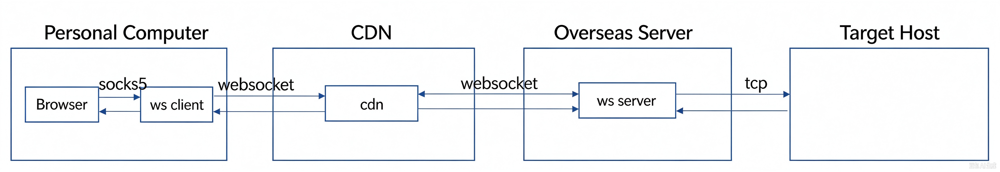

# netty-websocket-proxy
A  implementation of Forward-proxy in Java base on netty4 framework.

# Features

- [x] TCP support
- [x] CDN support
- [x] SOCKS5 support


# Environment
* 源码与字节码目标为 Java 8；已改用 `java.util.Base64`，可在 JDK 8 / 11 / 17 / 21 下编译（JDK 21 下用 `javac --release 8` 验证通过）

# Install
1. download netty-websocket-proxy-x.x.x-bin.tar.gz
2. tar -xzvf netty-websocket-proxy-x.x.x-bin.tar.gz
3. run
#### as swserver
```
java -jar ./bin/netty-websocket-proxy-x.x.x.jar -s -conf="./conf/config-example-server.json"
```
#### as swclient
```
java -jar ./bin/netty-websocket-proxy-x.x.x.jar -c -conf="./conf/config-example-client.json"
```
  Note: You can also use the command under bin to start the service. After the service starts, you can use Google Chrome and install the SwitchyOmega plug-in to surf the Internet

# Config

Server side (`-s`) and client side (`-c`) share the same config format:

| 字段 | 说明 |
|---|---|
| `server` | 服务端(`-s`)是监听地址，客户端(`-c`)是要连接的远端地址 |
| `port_password` | key 是端口，value 是该端口的密码；两端必须一致 |
| `payload_cipher` | 可选，缺省 `aes-256-gcm`。隧道载荷加密开关，只有 `none` 表示关闭，其余值一律按 `aes-256-gcm` 处理。**两端必须一致**，详见下一节 |
| `local_address` / `local_port` | 仅客户端使用，本地 SOCKS5 监听地址与起始端口 |
| `boss_threads` | 可选，缺省 `1`。只监听一个端口时多开无意义 |
| `worker_threads` | 可选，缺省 `0` = Netty 默认（`2 × CPU`）。代理场景建议按并发连接数显式指定 |
| `use_epoll` | 可选，缺省 `true`。Linux 上优先用 epoll；native 库不可用时**自动回退 NIO**，不会启动失败 |
| `so_reuseport` | 可选，缺省 `false`。仅在 epoll 生效，多进程绑同一端口做负载均衡时打开 |
| `receive_buffer` / `send_buffer` | 可选，缺省**不设置**。即 `SO_RCVBUF` / `SO_SNDBUF`，单位字节。**非必要不要动**，理由见下文 |
| `stats_interval_seconds` | 可选，缺省 `60`；`≤0` 表示关闭周期性统计。统计跑在 worker event loop 上（不额外起线程），内容为活跃连接数、隧道/目标建连成功率、DNS 缓存命中率 |

> 统计日志每 `stats_interval_seconds` 秒往 `logs/sw-proxy.log` 打一行，形如：
> ```
> stats: active[socks=3, tunnel=3, target=2] tunnelConnect[attempt=12, success=12, fail=0, rate=100.0%] targetConnect[attempt=9, success=8, fail=1, rate=88.9%] dns[hit=7, miss=2, ipLiteral=1, rejected=0, hitRate=77.8%]
> ```
> 成功率按 `成功 / (成功 + 失败)` 算，分母为 0 时显示 `n/a`。活跃连接数是当前值，其余是进程级累计值。

> 要用上 epoll，需要把 `netty-transport-native-epoll` 的 `linux-x86_64` classifier 包放进 classpath，
> 否则 `Epoll.isAvailable()` 返回 false，程序照常以 NIO 启动（启动日志里会打印 `transport=nio`）。

### 关于隧道加密 `payload_cipher`

**缺省开启。** 加密对象是隧道里每个 WebSocket Binary 帧的**载荷**（你真正在代理的应用数据）；
握手 URL 里的 `token` 是另一套独立机制（加密目标地址），两者互不影响。

密钥链路：

```
端口密码 ──PBKDF2-HMAC-SHA256, 12 万次, 启动预热──▶ 主密钥
主密钥 + 每连接 8B 随机 salt + 方向标签 ──HKDF-SHA256──▶ c2s / s2c 两把独立的 AES-256 密钥
```

salt 以明文随握手 URL 传（`&salt=...`，它不是秘密），作用只是让每条连接、每个方向的密钥都不同。
**握手不增加往返**：salt 搭在已有的 WS 握手上，PBKDF2 已在启动阶段热身过。

记录格式（也就是 WS Binary 帧的 payload；真正落到 socket 上还要加 2~14 字节 WS 帧头，
那是本来就要付的开销，与加密无关）：

```
seq(4B) | ciphertext(n B) | tag(16B)          整条长度恒为 n + 20
```

* `n` 就是明文长度 —— GCM 内部是 CTR 流，密文与明文等长，这也是能就地改写的先决条件。
* `seq` 严格 +1，既当 GCM IV 的低 32 位（高 8 字节是 salt），又当 AAD。重放、乱序、把上行密文
  反射回下行都会在认证处失败并断连 —— 不会有一字节未认证的明文漏给下游。
* 明文被**就地**改写成密文，不额外拷贝、也不扩容，大包没有额外内存开销。
* 代价是每帧固定多 20 字节（seq + tag）。
* **一条记录必须完整装在一个 WS 帧里**：`WebSocketByteBufCodec` 直接把 `msg.content()` 交给
  解密，不重组分片；记录也不接受多段缓冲（拿 seal 产出的 3 段 composite 去 `open` 会直接报
  `record buffer must be contiguous, components=3`）。单帧上限是对端的 `maxFramePayloadLength`
  （客户端 320KB），而中继按 TCP 读缓冲切帧，实际远低于这个值。

**两端必须一致。** 协议里没有协商（协商要多一次 RTT）：一端开、一端关时，TCP 与 WS 握手都会
成功，但隧道建立后的第一帧就认证失败、连接被断开。默认日志级别是 `info`，而这条失败信息是
`debug` —— **日志里什么都看不到**，只表现为「连上就断」。排查办法：

1. 比对两端启动日志，各有一行 `payload cipher: aes-256-gcm`；
2. 客户端侧看隧道 URL 有没有 `&salt=` 后缀（有就是开了）；
3. 把 `cn.wowspeeder` 调到 `debug`，才能看到 `payload cipher failed, closing tunnel: ...`。

另外 `payload_cipher` 开启时握手 URL **必须**带 salt，缺失会在服务端报
`url args not right please check: salt is required when payload cipher is on`（这条是 error 级，能看到）。

**升级注意：** 老版本没有这层加密，而新版本缺省是开的。只升级一端必然连不上 —— 要么两端在同一
时间窗口一起升，要么先把已升级那端显式设成 `none`，两边都升完再统一切回 `aes-256-gcm`。

性能参考（单条记录，含每帧一次 `Cipher.init`）：1.4KB 约 3 µs、32KB 约 16 µs（JDK 21）/ 32 µs
（JDK 8），即单核 0.5~2 GB/s，千兆链路远不是瓶颈。真正需要留意的是那 20 字节：1448B 帧只占
1.4%，但 256B 以下的小包会占到 8%~30%，高 pps 场景下是显性成本。

配置示例：

```json
{
  "server": "0.0.0.0",
  "port_password": { "443": "889900" },
  "payload_cipher": "aes-256-gcm",
  "stats_interval_seconds": 60
}
```

### 关于 `SO_RCVBUF` / `SO_SNDBUF`

**默认不设置，交给内核按实测 BDP 自动调优。** 这不是偷懒，而是刻意的：把这两个选项写死会带来两重副作用。

**1. 写入的值会被内核先截断、再翻倍，调用方根本控制不住。**
Linux 的 `setsockopt` 大致是这样做的：

```c
if (val > sysctl_wmem_max) val = sysctl_wmem_max;   /* 先截断 */
sk_sndbuf = val * 2;                                /* 再翻倍，一半留给簿记开销 */
```

`net.core.rmem_max` / `wmem_max` 的**默认值只有 208KB**，所以传 `2 * 1024 * 1024` 会先被砍到 208KB、
再翻成 416KB —— 你写的 2MB 和最终生效值毫无关系。也就是说，原来代码里那几行 `2MB` 是**写了个寂寞**。

**2. 一旦设置就关闭内核自动调优。**
该调用会给 socket 打上 `SOCK_RCVBUF_LOCK` / `SOCK_SNDBUF_LOCK` 标记，此后内核不再按实测 BDP 自动增长缓冲区。
而链路的 BDP（带宽 × RTT）是未知的：

| 带宽 | RTT | 所需缓冲(BDP) |
|---|---|---|
| 100 Mbps | 20 ms | ~0.24 MB |
| 100 Mbps | 80 ms | ~0.95 MB |
| 500 Mbps | 80 ms | ~4.8 MB |
| 1 Gbps | 150 ms | ~18 MB |
| 10 Gbps | 150 ms | ~180 MB |

写死 2MB 只够百兆级 + 中等 RTT，在千兆/万兆链路上必然成为吞吐瓶颈 —— **比不设置还慢**。

**只有以下情况才值得显式指定**，并且要注意两条约束：

* 需要限制单连接内存占用（例如几万条并发连接的接入机）；
* 已经清楚链路特征，要固定窗口做压测对比。

约束一：**至少要 256KB**，低于内核默认上限（208KB）的值会被静默截断。
约束二：改之前先调大 sysctl，否则填大值也不生效：

```bash
sysctl -w net.core.rmem_max=16777216
sysctl -w net.core.wmem_max=16777216
# 持久化写进 /etc/sysctl.conf
```

配置示例（不想要就写 `0` 或直接删掉这两个 key，效果一样）：

```json
{
  "receive_buffer": 524288,
  "send_buffer": 524288
}
```

> 补充：这两个值只会被设在**已接受的连接**（`childOption`）和**出站连接**上。
> 父 channel（监听 socket）上的同名字段对连接毫无作用 —— 历史上确实有一处
> `.option(ChannelOption.SO_RCVBUF, ...)` 写在了父 channel 上，属于无效代码，已删除。

### 关于域名解析

`server`（客户端侧）与目标地址（服务端侧）都支持填域名，解析是**异步**的、并且带 TTL 缓存
（成功 60s、失败 5s），不会阻塞 event loop。若遇到解析异常，先确认目标地址没有写错——
密码不对时服务端会在解密阶段就失败，不会走到解析。

**UDP 未实现**：项目只做 TCP 转发。客户端发起 SOCKS5 `UDP_ASSOCIATE` 时，本地端会返回
`COMMAND_UNSUPPORTED (0x07)` 并关闭连接，请让客户端回退到 TCP（历史上这里错误地返回 `SUCCESS`，
导致 UDP 数据被静默丢弃）。

# Build
1. import as maven project
2. maven package

## TODO
* [ ] performance optimization
* [ ] android client
## Data flow

   Note: CDN is optional
